<p align="center">
  
</p>

<h1 align="center">MeetCap</h1>

<h3 align="center">只管开口，句句在手。</h3>

<p align="center">
  <a href="https://meetcap.seacen.dev/download"><picture><source media="(prefers-color-scheme: dark)" srcset="assets/download-zh-dark.svg"></picture></a>
</p>

<p align="center">
  <a href="https://github.com/seacen/meetcap/releases/latest"></a>
  
  
  
</p>

<p align="center">
  <a href="https://meetcap.seacen.dev/zh-cn/">官网</a> · <a href="https://meetcap.seacen.dev/zh-cn/docs/">帮助</a> · <a href="https://meetcap.seacen.dev/zh-cn/feedback/">反馈</a> · <a href="./README.md">English</a> · <b>简体中文</b>
</p>

随时随地开录，免费不限次。会中实时小结与生词介绍，走神和话题不熟再也不怕；会后高质量纪要直出，助你场场有成果、决策有沉淀。录音全程本地处理，隐私有保障。不论你在用什么 AI，都能轻松和 MeetCap 打交道：录会、查历史，还是为它提供珍贵上下文，一切一句话搞定。

<!-- 演示动图放这里：在智能体里说一句“录下这场会”，菜单栏图标变成红点。 -->

## 这些时候用得上

- **会开到一半，聊到你不熟的话题**：术语、缩写一个接一个，扫一眼实时小结，就知道它们是什么、跟这场会有什么关系。
- **一天连开五六场**：到点自动开录，散会就有纪要，不用再占掉晚上去整理。
- **中英夹杂、满口缩写**：照样转得准，纪要按你们自己的写法写。
- **录音不能出公司**：语音识别、分说话人都用电脑上的本地模型，录音不出电脑。纪要可以交给公司自己的模型写，也可以用 MeetCap 提供的本地模型来写，连文字都不出电脑。
- **几周后要用到会上的内容**：问你的 AI 一句“上个月和供应商谈的价格是多少”，它直接从会议记录里找出来。

## 懂上下文

会上跟得上，会后写得准，因为它知道这场会的背景。

- **会上**：每隔几分钟出一段小结，附上会上陌生的术语、产品或事件是什么，跟这场会有什么关系。
- **会后**：先把听错的人名、术语改对，再写纪要；同一系列的会，接着上一场写。
- **越用越懂你们的说法**：确认过的写法记进术语表，下次就写对。
- **会自己做功课**：用智能体时，它会去你的日历、邮件和文档里查参会人、议程和项目背景。

## 强大且免费、开放

### 强大

- **纪要专业**：打开纪要，一分钟看懂为什么开、各议题落在哪，两分钟知道全部要紧的事和谁接下来做什么；能直接转发，也能导出 Word、PDF。
- **句句有据**：纪要每一条都链到逐字稿里的原话，点任何一句都能回听；可能听错的句子会标出来。
- **分清谁说的**：自动分出说话人，按对话里的线索猜出是谁、请你确认；给说话人起过一次名字，以后开会就能认出来。
- **中英都行**：中英混说照样识别，纪要可以出中英两份。
- **逐字稿又快又准**：会上边说边出字幕；散会后整场重新识别一遍，更准；开着外放，也不会出现重复的句子。
- **什么会都能录**：任何会议软件或浏览器里的会、线下会、已有的录音文件都行；菜单栏、快捷键、智能体、定时都能开录。
- **靠得住**：断网照常录，程序意外退出也不丢；16 GB 内存的电脑和会议软件、浏览器一起开着也跑得动。

### 免费

这么多功能，在自己电脑上用，全部免费：不限时长，不锁功能，不用注册。纪要交给你选的 AI，想出多少出多少。模型费直接付给服务商，MeetCap 不经手；用本地模型，连这笔也省了。

### 开放

- **AI 任你选**：小结和纪要交给谁写由你选：你电脑上任意一个智能体、自己的 API 密钥，或 MeetCap 提供的本地模型。不管用哪种，都按同一套要求写，随时可以换。
- **存在哪你定**：会议记录放在你的电脑上，或者放进你自己的 iCloud 云盘、OneDrive。换台电脑打开，纪要都在，起过名的人也照样认得出。放进 iCloud 上的 Obsidian 仓库，在 iPhone 的 Obsidian 里也能看纪要。
- **记录是你的文件**：纪要和逐字稿就是你文件夹里的 Markdown 文件，Obsidian 直接打开，任何智能体都能读。哪天不用 MeetCap 了，它们还在原处，照样能打开。
- **录音不出电脑**：录音只在录它的那台电脑上转写、保存，同步时也不跟着走。发出去的只有文字，发给你选的那家 AI；用本地模型，连文字也不出电脑。

## AI 原生

在智能体里说一句，MeetCap 照做；在 MeetCap 里点一下，它会去叫你的智能体。哪边顺手用哪边。

- **在智能体里用**：任意支持 Skill 的智能体（Claude Code、Codex 等）都能用。和它直接对话，它自动知道与 MeetCap 交互：不论是开始、停止录制，给说话人起名，写小结和纪要，查会议历史，还是会中随时辅助你，一切都如此丝滑。
- **在 MeetCap 里用**：不想开对话，点一下菜单栏。会中小结和会后纪要，MeetCap 交给你电脑上的智能体在后台写好。二十多种智能体都能接，用你现有的订阅，不用另外花钱。
- **用自己的 API 密钥**：没有智能体，就填一个 API 密钥：Claude API 或任何兼容 OpenAI 的服务都行。逐字稿只发给这一家。
- **用本地模型**：让 MeetCap 下载装好一个本地模型，小结和纪要就在你的电脑上写，不用密钥，也不用账号。
- **以前的会，问一句就找到**：每场会都存成普通文件，能读文件的 AI 都查得到；谁说过什么、定过什么，问一句就翻出来。

## 安装

**[下载 MeetCap for Mac →](https://meetcap.seacen.dev/download)** 打开后跟着首次设置走几步就好。

需要 macOS 14.2 或更高版本的 Mac，Apple 芯片和 Intel 都可以；Windows 和 iPhone 版在路上。

习惯用终端的话，一行命令也能装：

```sh
curl -fsSL https://meetcap.seacen.dev/install.sh | bash
```

权限、模型、卸载等其余说明见[文档站](https://meetcap.seacen.dev/zh-cn/docs/)。

## 反馈与建议

需要 MeetCap 还没有的功能，先查看[大家提过的建议](https://github.com/seacen/meetcap/issues?q=is%3Aissue+is%3Aopen+label%3Aenhancement+sort%3Areactions-%2B1-desc)，有一样的就点个 👍。报问题、提新的建议或者发邮件，都在[反馈与建议](https://meetcap.seacen.dev/zh-cn/feedback/)页。

## 隐私与条款

[隐私说明](./PRIVACY.zh-CN.md) · [使用条款](./TERMS.zh-CN.md) · [第三方声明](https://meetcap.seacen.dev/download/latest/ThirdPartyNotices.txt)。仓库里的 LICENSE 就是英文版使用条款。MeetCap 不开源，本仓库只放发布版本和智能体用的 skill。

---

© 2026 Seacen Zhao · MeetCap by Seacen
